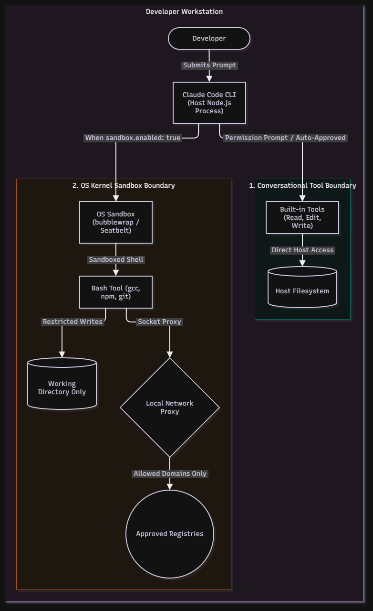
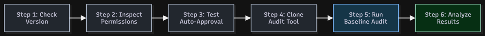

# Understanding Claude Code Architecture & Baseline Security Auditing

In modern software development, AI coding assistants are evolving from simple autocomplete suggestions into fully autonomous agents. **Anthropic Claude Code** operates directly inside your terminal: it navigates directories, edits project files, runs shell commands, and connects to external APIs to write and debug software.

However, giving an autonomous agent local system access introduces a fundamental security challenge: **How do we enable Claude Code to work productively while ensuring it cannot damage our host system or expose sensitive credentials?**



This hands-on lab introduces you to Claude Code’s execution architecture, its dual security boundaries, and how to perform an automated offline security audit to verify your baseline environment.

---

## Lab Overview

In this lab, you will:

- Understand Claude Code’s runtime model as a local host process.
- Distinguish between **Tool Permission Boundaries** (prompt-based) and **OS Kernel Sandboxing** (system-level).
- Identify which tools run inside versus outside the operating system sandbox.
- Download and set up the open-source **`coding-agent-security`** audit suite.
- Execute your first automated security audit and evaluate baseline checks (`I01`, `U00`, `U01`, `U02`).

---

## Concepts Explained

Before touching the terminal, let’s understand the core technical concepts:

### 1. What is Anthropic Claude Code?

Claude Code is an agentic coding tool that executes on your machine. Rather than answering questions in a browser sandbox, Claude Code runs directly in your terminal, IDE, or container. It reads code, writes patches, runs builds, and executes test suites autonomously.

### 2. Tool Boundaries vs. OS Kernel Boundaries

- **Tool Permission Boundary (Conversational):** Claude Code prompts you in the terminal before performing an action (e.g., *“Allow Bash command `npm test`?”*). While helpful, prompts rely on human attention and are susceptible to approval fatigue. Once approved, the command runs with your user account’s full privileges.
- **OS Kernel Boundary (Sandboxing):** Enforced by the operating system kernel (macOS Seatbelt or Linux `bubblewrap`). It physically restricts what files shell processes can read or write and blocks unauthorized network requests—regardless of what prompt the LLM received.

### 3. The “Out-of-Sandbox” Reality

A critical architectural detail: **Only shell commands (`Bash`) run inside Claude Code’s OS sandbox.** Built-in file tools (`Read`, `Edit`, `Write`) and local extensions run outside the sandbox. Securing Claude Code requires combining both permission rules and OS sandboxing.

---

## Step-by-Step Hands-On Instructions

---



### Step 1: Verify Claude Code Version & Security Baseline

Security vulnerabilities in coding agents are frequently patched in new CLI releases:

- **v1.0.111:** Patched CVE-2025-59536 (pre-trust execution vulnerability).
- **v2.1.179:** Patched Plugin4Shell (silent branch-swap supply chain attack).
- **v2.1.219:** Introduced strict network allowlists (`sandbox.network.strictAllowlist`).

Check your installed CLI version:

```bash
claude --version
```

**Expected Output:**

```
claude-code/2.1.219 (or higher)
```

> [!TIP]
> If your version is older than `2.1.219`, run `claude update` to ensure all modern security controls and audit checks are supported.

---

### Step 2: Create a Workspace & Inspect Default Permissions

Create a clean directory for this lab:

```bash
mkdir -p ~/claude-security-labs/lab1
cd ~/claude-security-labs/lab1
git init
```

Launch Claude Code in interactive mode:

```bash
claude
```

Inside the interactive Claude Code prompt:

1. Type `/permissions` and press Enter to view active tool permissions.
2. Notice the starting mode: **Manual (Default)**. In this mode, Claude Code starts with read-only permissions and prompts before running non-read-only commands or editing files.
3. Type `/config` to see settings loaded at user and project scopes.
4. Exit the session by typing `/exit`.

---

### Step 3: Observe Safe Read-Only Command Auto-Approval

Claude Code uses a built-in classifier to allow safe, read-only commands without interrupting you with confirmation dialogs.

Create a simple project file:

```bash
echo "Claude Code Architecture Lab" > README.md
```

Run Claude Code in non-interactive print mode (`-p`):

```bash
claude -p "What is the project title in README.md?"
```

**What Happened Behind the Scenes:**

1. Claude Code called the native `Read` tool or `cat README.md` via `Bash`.
2. Because reading files inside the project working directory is classified as safe, it ran without a permission prompt.
3. Claude returned the answer directly to your terminal.

---

### Step 4: Clone the Security Audit Suite

To verify your security posture against industry standards, we use the open-source **`coding-agent-security`** audit tool maintained by AI Security Labs.

Clone the repository into your home directory:

```bash
git clone https://github.com/aisecuritylabs-org/coding-agent-security.git ~/coding-agent-security
```

Verify that the audit scripts are ready:

```bash
ls -l ~/coding-agent-security/claude-code/audit
```

The directory includes:

- `audit.sh`: The core bash audit engine (runs offline, read-only).
- `run.sh`: Linux/macOS launcher.
- `run.ps1`: Windows PowerShell launcher.
- `mappings.json`: Framework cross-references (OWASP, MITRE ATLAS, NIST).

---

### Step 5: Run Your First Baseline Security Audit

The audit tool is completely **read-only and offline**. It inspects your Claude Code settings (`~/.claude/settings.json`), permissions, hooks, and project configurations without making network requests.

Run the audit against your environment:

- **On Linux, macOS, or WSL2:**

  ```bash
  ~/coding-agent-security/claude-code/audit/run.sh
  ```
- **On Windows (PowerShell):**

  ```powershell
  & "$HOME\coding-agent-security\claude-code\audit\run.ps1"
  ```

You will see an on-screen summary report:

```
================================================================================
Claude Code Security Audit (v1.3.0)
Target: /home/user (~/.claude)
================================================================================

[PASS] I01: Claude Code version 2.1.219 supports every setting in the baseline
[WARN] U01: No ~/.claude/settings.json (Claude Code running on defaults)
[FAIL] U02: Sandbox is not enabled
[WARN] U06: Sandbox does not block reads of ~/.ssh
[WARN] U07: No deny rule for .env files
...
================================================================================
Audit Complete: 1 PASS, 12 WARN, 3 FAIL
================================================================================
```

---

### Step 6: Interpret Key Baseline Checks

Let’s analyze what the audit discovered about our initial environment:

| Check ID      | Status   | Meaning                               | Real-World Impact                                                     |
| ------------- | -------- | ------------------------------------- | --------------------------------------------------------------------- |
| **I01** | `PASS` | Claude Code CLI version is >= 2.1.219 | Patched against CVE-2025-59536 and Plugin4Shell.                      |
| **U01** | `WARN` | No `~/.claude/settings.json` file   | Running on unconfigured defaults without custom deny rules.           |
| **U02** | `FAIL` | Sandbox is disabled                   | Approved shell commands run uncontained with full host access.        |
| **U06** | `WARN` | Sandbox permits reads of `~/.ssh`   | If sandboxing is turned on without masking, private keys can be read. |

In **Labs 2 through 5**, you will systematically resolve every one of these `WARN` and `FAIL` findings.

---

## Quick Reference Summary

| Action                        | Command                                              | Purpose                                                    |
| ----------------------------- | ---------------------------------------------------- | ---------------------------------------------------------- |
| **Check Version**       | `claude --version`                                 | Verify CLI version and ensure security patches are active. |
| **Inspect Permissions** | `/permissions` *(inside Claude)*                 | View active tool permissions and allow/deny rules.         |
| **Inspect Settings**    | `/config` *(inside Claude)*                      | View active configuration across user and project scopes.  |
| **Run Offline Audit**   | `~/coding-agent-security/claude-code/audit/run.sh` | Perform a comprehensive 39-check security audit.           |

---

## Conclusion

Congratulations! You have completed **Lab 1**. You now understand:

1. How Claude Code operates as a native host binary with direct system access.
2. The fundamental difference between conversational permission prompts and OS kernel sandboxing.
3. Why relying on prompt approvals alone creates security risks.
4. How to run an automated, offline security audit to evaluate your environment’s risk posture.

### What’s Next?

In **Lab 2: Securing Agent Permissions & Command Execution**, you will explore Claude Code’s six permission modes, eliminate dangerous wildcard allow rules, and lock down shell execution using fine-grained `Tool(specifier)` syntax.
